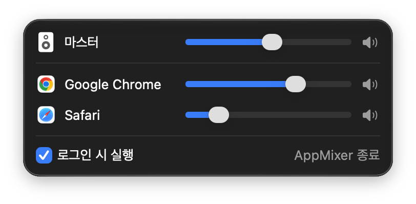
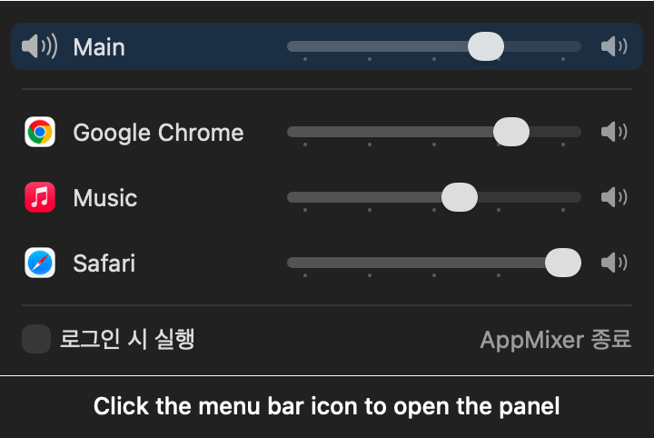

# AppMixer

[한국어](README.md) | English

A macOS menu bar app for controlling volume per app.



macOS has no equivalent of the Windows Volume Mixer, so you can only change the volume of the whole system. AppMixer shows the apps currently playing sound in a menu bar panel and lets you adjust or mute each one separately.

The app's interface is in Korean, except for the Main label.

## Features

- Automatically detects apps playing sound and lists them
- Per-app volume and mute. Unmuting returns to the previous volume.
- System master volume control, kept in sync with the keyboard volume keys
- Per-app settings are saved and persist when an app or AppMixer restarts
- Automatically follows the output device when it changes (for example, when you connect earphones)
- Launch at login
- Runs only in the menu bar, with no Dock icon

## Usage

Click the menu bar icon to open the panel. **Main** at the top is the system-wide volume, and the apps playing sound are listed below it.



This is the real panel rendered with demo data.

- **Adjust volume:** Move the slider. The tick marks are 25% apart.
- **Mute:** Click the speaker button on the right of a row. Click it again to return to the previous volume.

### Keyboard controls

These are available while the panel is open.

| Key | Action |
|---|---|
| <kbd>↑</kbd> <kbd>↓</kbd> | Select the row to adjust |
| <kbd>←</kbd> <kbd>→</kbd> | Adjust volume by 1% |
| <kbd>⌘</kbd> + <kbd>←</kbd> <kbd>→</kbd> | Adjust volume by 5% |

### Permissions

> The first time you change an app's volume, macOS asks for the **System Audio Recording** permission. AppMixer needs it to take another app's audio and apply the volume. AppMixer does not save or transmit the audio it takes, and it has no network features.

## How it works

AppMixer uses Core Audio's **Process Tap** API, added in macOS 14.2. It takes the audio of an app whose volume has been lowered, applies the volume, and sends the result back out to the output device.

Most earlier per-app volume apps required installing a virtual audio driver. AppMixer needs no driver installation or administrator privileges. An app at 100% volume that isn't muted bypasses AppMixer and plays through its original path, and quitting AppMixer returns all app audio to normal.

## Requirements

- macOS 14.2 or later
- Apple silicon or Intel Mac

## Installation

1. Download `AppMixer-x.y.z.dmg` from [Releases](https://github.com/dgim9390/AppMixer/releases/latest) and open it.
2. In the window that opens, drag `AppMixer` to the `Applications` folder.
3. The first time only, you need to allow it to run using one of the methods below.

### First launch

AppMixer is not notarized by Apple. So when you first open it, macOS blocks it and warns that Apple could not verify that AppMixer is free of malware. Allow it once using either method below, and it opens normally from then on.

**Allow it in System Settings**

1. Double-click `AppMixer` in the `Applications` folder, then click **Done** in the warning dialog.
2. Go to **System Settings → Privacy & Security**.
3. In the Security section further down, click **Open Anyway** next to the message that AppMixer was blocked, then enter your password.
4. In the confirmation dialog that appears, click **Open**.

**Allow it in Terminal**

```bash
xattr -dr com.apple.quarantine /Applications/AppMixer.app
```

This command removes the quarantine flag attached to downloaded files. Once it has run, you can simply double-click the app to open it.

### Build from source

Requires Xcode and [XcodeGen](https://github.com/yonaskolb/XcodeGen).

```bash
brew install xcodegen
git clone https://github.com/dgim9390/AppMixer.git
cd AppMixer
xcodegen generate
xcodebuild -project AppMixer.xcodeproj -scheme AppMixer -configuration Release -derivedDataPath build build
cp -R build/Build/Products/Release/AppMixer.app /Applications/
```

## Limitations

- Chrome plays the sound of all its tabs and web apps (PWAs) through a single process. They are therefore grouped under one "Google Chrome" entry and adjusted together.
- There is no output device picker. Change the device in macOS Control Center and AppMixer follows it.

## Troubleshooting

- **An app's volume doesn't change:** Allow AppMixer in System Settings → Privacy & Security → Screen & System Audio Recording.
- **Reset settings:** Run `defaults delete com.dgim9390.AppMixer`, then restart AppMixer.

## Development

AppMixer is written in Swift and SwiftUI and has no external dependencies. The audio engine sits behind the `AudioEngine` protocol, so the UI code doesn't depend on Core Audio. The design and implementation notes are in [docs/DESIGN.md](docs/DESIGN.md) (Korean), and how the app detection delay was measured and fixed is in [docs/detection-latency.md](docs/detection-latency.md) (Korean).

```bash
xcodegen generate
xcodebuild -project AppMixer.xcodeproj -scheme AppMixer -derivedDataPath build test
```

`.xcodeproj`, `Info.plist`, and `.entitlements` are generated from `project.yml`, so don't edit them directly.

To build a DMG for distribution, raise `CFBundleShortVersionString` in `project.yml` and run the command below. It creates `dist/AppMixer-<version>.dmg`. This requires [uv](https://github.com/astral-sh/uv) ([dmgbuild](https://github.com/dmgbuild/dmgbuild) lays out the DMG window).

```bash
./dmg/build.sh
```

- DMG window background and icon positions: `dmg/make-background.swift`, `dmg/settings.py`
- App icon: regenerate it with `swift scripts/make-icon.swift`.
- Demo GIF: build and run instructions are at the top of `scripts/make-demo.swift`.

## License

[MIT](LICENSE)
