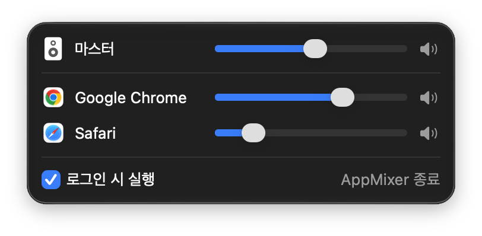

# AppMixer

macOS 메뉴바에서 앱별로 볼륨을 조절하는 앱입니다.



macOS에는 Windows의 볼륨 믹서 같은 기능이 없어서 시스템 전체 볼륨만 바꿀 수 있습니다. AppMixer는 메뉴바 패널에 지금 소리를 내는 앱 목록을 보여 주고, 앱마다 볼륨을 따로 조절하거나 음소거할 수 있게 해 줍니다.

## 기능

- 소리를 내는 앱을 자동으로 감지해 목록에 표시
- 앱별 볼륨 조절과 음소거. 음소거를 해제하면 이전 볼륨으로 돌아갑니다.
- 시스템 마스터 볼륨 조절. 키보드 볼륨 키와 연동됩니다.
- 앱별 설정 저장. 앱이나 AppMixer를 다시 실행해도 유지됩니다.
- 출력 장치가 바뀌면(이어폰 연결 등) 자동으로 따라감
- 로그인 시 자동 실행
- Dock 아이콘 없이 메뉴바에서만 동작

## 동작 방식

macOS 14.2에 추가된 Core Audio의 **Process Tap** API를 사용합니다. 볼륨을 낮춘 앱의 오디오를 가져와 볼륨을 적용한 뒤 출력 장치로 다시 내보냅니다.

기존의 앱별 볼륨 앱들은 대부분 가상 오디오 드라이버를 설치해야 했습니다. AppMixer는 드라이버 설치나 관리자 권한이 필요 없습니다. 볼륨이 100%이고 음소거되지 않은 앱은 거치지 않고 원래 경로로 재생되며, AppMixer를 종료하면 모든 앱 소리가 원래대로 돌아옵니다.

## 요구 사항

- macOS 14.2 이상
- Apple Silicon 또는 Intel Mac

## 설치

1. [Releases](https://github.com/dgim9390/AppMixer/releases/latest)에서 `AppMixer-x.y.z.zip`을 내려받아 압축을 풉니다.
2. `AppMixer.app`을 `응용 프로그램` 폴더로 옮깁니다.
3. 처음 한 번은 아래 방법으로 실행을 허용해야 합니다.

### 처음 실행할 때

AppMixer는 Apple 공증(notarization)을 받지 않은 앱입니다. 그래서 처음 열면 macOS가 "Apple은 'AppMixer'에 악성 코드가 없음을 확인할 수 없습니다"라는 경고와 함께 실행을 막습니다. 아래 방법 중 하나로 한 번만 허용하면, 그다음부터는 바로 실행됩니다.

**시스템 설정에서 허용**

1. `AppMixer.app`을 더블클릭하고, 경고 창에서 **완료**를 누릅니다.
2. **시스템 설정 → 개인정보 보호 및 보안**으로 이동합니다.
3. 아래쪽 보안 항목에 있는 "'AppMixer'이(가) 차단되었습니다" 옆의 **그래도 열기**를 누르고 암호를 입력합니다.
4. 다시 나오는 확인 창에서 **열기**를 누릅니다.

**터미널에서 허용**

```bash
xattr -dr com.apple.quarantine /Applications/AppMixer.app
```

이 명령은 내려받은 파일에 붙는 격리 표시를 지웁니다. 실행 후에는 그냥 더블클릭하면 열립니다.

### 소스에서 빌드

Xcode와 [XcodeGen](https://github.com/yonaskolb/XcodeGen)이 필요합니다.

```bash
brew install xcodegen
git clone https://github.com/dgim9390/AppMixer.git
cd AppMixer
xcodegen generate
xcodebuild -project AppMixer.xcodeproj -scheme AppMixer -configuration Release -derivedDataPath build build
cp -R build/Build/Products/Release/AppMixer.app /Applications/
```

## 사용법

메뉴바 아이콘을 클릭하면 패널이 열립니다. 맨 위는 시스템 전체 볼륨이고, 그 아래에 소리를 내는 앱이 표시됩니다.

처음 앱 볼륨을 바꿀 때 macOS가 **시스템 오디오 녹음** 권한을 요청합니다. 다른 앱의 오디오를 가져와 볼륨을 적용하려면 이 권한이 필요합니다. AppMixer는 가져온 오디오를 저장하거나 전송하지 않으며, 네트워크 기능이 없습니다.

## 제한 사항

- Chrome은 모든 탭과 웹앱(PWA)의 소리를 하나의 프로세스에서 냅니다. 그래서 이들은 "Google Chrome" 한 항목으로 묶여 함께 조절됩니다.
- 출력 장치 선택 기능은 없습니다. macOS 제어 센터에서 바꾸면 AppMixer가 따라갑니다.

## 문제 해결

- **앱 볼륨이 바뀌지 않음:** 시스템 설정 → 개인정보 보호 및 보안 → 화면 및 시스템 오디오 녹음에서 AppMixer를 허용해 주세요.
- **설정 초기화:** `defaults delete com.dgim9390.AppMixer`를 실행한 뒤 AppMixer를 다시 실행합니다.

## 개발

Swift와 SwiftUI로 작성했으며 외부 의존성은 없습니다. 오디오 엔진은 `AudioEngine` 프로토콜 뒤에 분리되어 있어서, UI 코드는 Core Audio에 의존하지 않습니다. 설계와 구현 기록은 [docs/DESIGN.md](docs/DESIGN.md)에 있습니다.

```bash
xcodegen generate
xcodebuild -project AppMixer.xcodeproj -scheme AppMixer -derivedDataPath build test
```

`.xcodeproj`, `Info.plist`, `.entitlements`는 `project.yml`에서 생성되므로 직접 수정하지 마세요.

배포용 zip 만들기: `project.yml`에서 `CFBundleShortVersionString`을 올린 뒤 실행합니다.

```bash
xcodegen generate
xcodebuild -project AppMixer.xcodeproj -scheme AppMixer -configuration Release -derivedDataPath build build
ditto -c -k --keepParent build/Build/Products/Release/AppMixer.app dist/AppMixer-1.0.0.zip
```

## 라이선스

[MIT](LICENSE)
