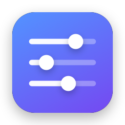
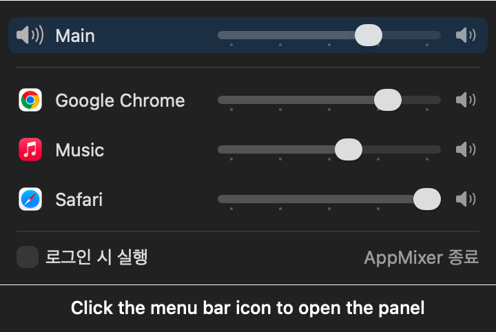

<p align="center">
  
</p>

<h1 align="center">AppMixer</h1>

<p align="center">macOS 메뉴바 앱별 볼륨 믹서<br>Per-app volume mixer for the macOS menu bar</p>

<details>
<summary><b>한국어</b></summary>

macOS 메뉴바에서 앱별로 볼륨을 조절하는 앱입니다.

macOS에는 Windows의 볼륨 믹서 같은 기능이 없어서 시스템 전체 볼륨만 바꿀 수 있습니다. AppMixer는 메뉴바 패널에 지금 소리를 내는 앱 목록을 보여 주고, 앱마다 볼륨을 따로 조절하거나 음소거할 수 있게 해 줍니다.

## 기능

- 소리를 내는 앱을 자동으로 감지해 목록에 표시
- 앱별 볼륨 조절과 음소거. 음소거를 해제하면 이전 볼륨으로 돌아갑니다.
- 시스템 마스터 볼륨 조절. 키보드 볼륨 키와 연동됩니다.
- 앱별 설정 저장. 앱이나 AppMixer를 다시 실행해도 유지됩니다.
- 출력 장치가 바뀌면(이어폰 연결 등) 자동으로 따라감
- 어디서든 단축키로 패널 열기
- 로그인 시 자동 실행
- Dock 아이콘 없이 메뉴바에서만 동작

## 사용법

메뉴바 아이콘을 클릭하거나 <kbd>⌃</kbd> + <kbd>⌥</kbd> + <kbd>X</kbd>를 누르면 패널이 열립니다. 맨 위 **Main**은 시스템 전체 볼륨이고, 그 아래에 소리를 내는 앱이 표시됩니다.




데모 데이터로 렌더링한 실제 패널 화면입니다.

- **볼륨 조절:** 슬라이더를 움직입니다. 눈금은 25% 간격입니다.
- **음소거:** 행 오른쪽의 스피커 버튼을 누릅니다. 다시 누르면 이전 볼륨으로 돌아갑니다.

### 키보드 조작

<kbd>⌃</kbd> + <kbd>⌥</kbd> + <kbd>X</kbd>는 어디서든 동작하고, 나머지 키는 패널이 열려 있을 때 사용할 수 있습니다.

| 키 | 동작 |
|---|---|
| <kbd>⌃</kbd> + <kbd>⌥</kbd> + <kbd>X</kbd> | 패널 열기/닫기 |
| <kbd>↑</kbd> <kbd>↓</kbd> | 조절할 행 선택 |
| <kbd>←</kbd> <kbd>→</kbd> | 볼륨 1%씩 조절 |
| <kbd>⌘</kbd> + <kbd>←</kbd> <kbd>→</kbd> | 볼륨 5%씩 조절 |

### 권한

> 처음 앱 볼륨을 바꿀 때 macOS가 **시스템 오디오 녹음** 권한을 요청합니다. 다른 앱의 오디오를 가져와 볼륨을 적용하려면 이 권한이 필요합니다. AppMixer는 가져온 오디오를 저장하거나 전송하지 않으며, 네트워크 기능이 없습니다.

## 동작 방식

macOS 14.2에 추가된 Core Audio의 **Process Tap** API를 사용합니다. 볼륨을 낮춘 앱의 오디오를 가져와 볼륨을 적용한 뒤 출력 장치로 다시 내보냅니다.

기존의 앱별 볼륨 앱들은 대부분 가상 오디오 드라이버를 설치해야 했습니다. AppMixer는 드라이버 설치나 관리자 권한이 필요 없습니다. 볼륨이 100%이고 음소거되지 않은 앱은 거치지 않고 원래 경로로 재생되며, AppMixer를 종료하면 모든 앱 소리가 원래대로 돌아옵니다.

## 요구 사항

- macOS 14.2 이상
- Apple Silicon 또는 Intel Mac

## 설치

1. [Releases](https://github.com/dgim9390/AppMixer/releases/latest)에서 `AppMixer-x.y.z.dmg`를 내려받아 엽니다.
2. 열린 창에서 `AppMixer`를 `Applications` 폴더로 끌어다 놓습니다.
3. 처음 한 번은 아래 방법으로 실행을 허용해야 합니다.

### 처음 실행할 때

AppMixer는 Apple 공증(notarization)을 받지 않은 앱입니다. 그래서 처음 열면 macOS가 "Apple은 'AppMixer'에 악성 코드가 없음을 확인할 수 없습니다"라는 경고와 함께 실행을 막습니다. 아래 방법 중 하나로 한 번만 허용하면, 그다음부터는 바로 실행됩니다.

**시스템 설정에서 허용**

1. `응용 프로그램` 폴더의 `AppMixer`를 더블클릭하고, 경고 창에서 **완료**를 누릅니다.
2. **시스템 설정 → 개인정보 보호 및 보안**으로 이동합니다.
3. 아래쪽 보안 항목에 있는 "'AppMixer'이(가) 차단되었습니다" 옆의 **그래도 열기**를 누르고 암호를 입력합니다.
4. 다시 나오는 확인 창에서 **열기**를 누릅니다.

**터미널에서 허용**

```bash
xattr -dr com.apple.quarantine /Applications/AppMixer.app
```

이 명령은 내려받은 파일에 붙는 격리 표시를 지웁니다. 실행 후에는 그냥 더블클릭하면 열립니다.

### 소스에서 빌드

Xcode와 [XcodeGen](https://github.com/yonaskolb/XcodeGen)이 필요합니다.

```bash
brew install xcodegen
git clone https://github.com/dgim9390/AppMixer.git
cd AppMixer
xcodegen generate
xcodebuild -project AppMixer.xcodeproj -scheme AppMixer -configuration Release -derivedDataPath build build
cp -R build/Build/Products/Release/AppMixer.app /Applications/
```

## 제한 사항

- Chrome은 모든 탭과 웹앱(PWA)의 소리를 하나의 프로세스에서 냅니다. 그래서 이들은 "Google Chrome" 한 항목으로 묶여 함께 조절됩니다.
- 출력 장치 선택 기능은 없습니다. macOS 제어 센터에서 바꾸면 AppMixer가 따라갑니다.

## 문제 해결

- **앱 볼륨이 바뀌지 않음:** 시스템 설정 → 개인정보 보호 및 보안 → 화면 및 시스템 오디오 녹음에서 AppMixer를 허용해 주세요.
- **설정 초기화:** `defaults delete com.dgim9390.AppMixer`를 실행한 뒤 AppMixer를 다시 실행합니다.

## 개발

Swift와 SwiftUI로 작성했으며 외부 의존성은 없습니다. 오디오 엔진은 `AudioEngine` 프로토콜 뒤에 분리되어 있어서, UI 코드는 Core Audio에 의존하지 않습니다. 설계와 구현 기록은 [docs/DESIGN.md](docs/DESIGN.md)에 있고, 앱 감지 지연을 측정하고 고친 과정은 [docs/detection-latency.md](docs/detection-latency.md)에 있습니다.

```bash
xcodegen generate
xcodebuild -project AppMixer.xcodeproj -scheme AppMixer -derivedDataPath build test
```

`.xcodeproj`, `Info.plist`, `.entitlements`는 `project.yml`에서 생성되므로 직접 수정하지 마세요.

배포용 DMG 만들기: `project.yml`에서 `CFBundleShortVersionString`을 올린 뒤 실행하면 `dist/AppMixer-<버전>.dmg`가 만들어집니다. [uv](https://github.com/astral-sh/uv)가 필요합니다(DMG 창 배치에 [dmgbuild](https://github.com/dmgbuild/dmgbuild)를 씁니다).

```bash
./dmg/build.sh
```

- DMG 창의 배경, 아이콘 위치: `dmg/make-background.swift`, `dmg/settings.py`
- 앱 아이콘: `swift scripts/make-icon.swift`로 다시 생성합니다.
- 데모 GIF: 빌드와 실행 방법은 `scripts/make-demo.swift` 맨 위에 있습니다.

## 라이선스

[MIT](LICENSE)

</details>

<details>
<summary><b>English</b></summary>

A macOS menu bar app for controlling volume per app.

macOS has no equivalent of the Windows Volume Mixer, so you can only change the volume of the whole system. AppMixer shows the apps currently playing sound in a menu bar panel and lets you adjust or mute each one separately.

The app's interface is in Korean, except for the Main label.

## Features

- Automatically detects apps playing sound and lists them
- Per-app volume and mute. Unmuting returns to the previous volume.
- System master volume control, kept in sync with the keyboard volume keys
- Per-app settings are saved and persist when an app or AppMixer restarts
- Automatically follows the output device when it changes (for example, when you connect earphones)
- Open the panel from anywhere with a keyboard shortcut
- Launch at login
- Runs only in the menu bar, with no Dock icon

## Usage

Click the menu bar icon or press <kbd>⌃</kbd> + <kbd>⌥</kbd> + <kbd>X</kbd> to open the panel. **Main** at the top is the system-wide volume, and the apps playing sound are listed below it.


This is the real panel rendered with demo data.

- **Adjust volume:** Move the slider. The tick marks are 25% apart.
- **Mute:** Click the speaker button on the right of a row. Click it again to return to the previous volume.

### Keyboard controls

<kbd>⌃</kbd> + <kbd>⌥</kbd> + <kbd>X</kbd> works from anywhere. The other keys are available while the panel is open.

| Key | Action |
|---|---|
| <kbd>⌃</kbd> + <kbd>⌥</kbd> + <kbd>X</kbd> | Open or close the panel |
| <kbd>↑</kbd> <kbd>↓</kbd> | Select the row to adjust |
| <kbd>←</kbd> <kbd>→</kbd> | Adjust volume by 1% |
| <kbd>⌘</kbd> + <kbd>←</kbd> <kbd>→</kbd> | Adjust volume by 5% |

### Permissions

> The first time you change an app's volume, macOS asks for the **System Audio Recording** permission. AppMixer needs it to take another app's audio and apply the volume. AppMixer does not save or transmit the audio it takes, and it has no network features.

## How it works

AppMixer uses Core Audio's **Process Tap** API, added in macOS 14.2. It takes the audio of an app whose volume has been lowered, applies the volume, and sends the result back out to the output device.

Most earlier per-app volume apps required installing a virtual audio driver. AppMixer needs no driver installation or administrator privileges. An app at 100% volume that isn't muted bypasses AppMixer and plays through its original path, and quitting AppMixer returns all app audio to normal.

## Requirements

- macOS 14.2 or later
- Apple silicon or Intel Mac

## Installation

1. Download `AppMixer-x.y.z.dmg` from [Releases](https://github.com/dgim9390/AppMixer/releases/latest) and open it.
2. In the window that opens, drag `AppMixer` to the `Applications` folder.
3. The first time only, you need to allow it to run using one of the methods below.

### First launch

AppMixer is not notarized by Apple. So when you first open it, macOS blocks it and warns that Apple could not verify that AppMixer is free of malware. Allow it once using either method below, and it opens normally from then on.

**Allow it in System Settings**

1. Double-click `AppMixer` in the `Applications` folder, then click **Done** in the warning dialog.
2. Go to **System Settings → Privacy & Security**.
3. In the Security section further down, click **Open Anyway** next to the message that AppMixer was blocked, then enter your password.
4. In the confirmation dialog that appears, click **Open**.

**Allow it in Terminal**

```bash
xattr -dr com.apple.quarantine /Applications/AppMixer.app
```

This command removes the quarantine flag attached to downloaded files. Once it has run, you can simply double-click the app to open it.

### Build from source

Requires Xcode and [XcodeGen](https://github.com/yonaskolb/XcodeGen).

```bash
brew install xcodegen
git clone https://github.com/dgim9390/AppMixer.git
cd AppMixer
xcodegen generate
xcodebuild -project AppMixer.xcodeproj -scheme AppMixer -configuration Release -derivedDataPath build build
cp -R build/Build/Products/Release/AppMixer.app /Applications/
```

## Limitations

- Chrome plays the sound of all its tabs and web apps (PWAs) through a single process. They are therefore grouped under one "Google Chrome" entry and adjusted together.
- There is no output device picker. Change the device in macOS Control Center and AppMixer follows it.

## Troubleshooting

- **An app's volume doesn't change:** Allow AppMixer in System Settings → Privacy & Security → Screen & System Audio Recording.
- **Reset settings:** Run `defaults delete com.dgim9390.AppMixer`, then restart AppMixer.

## Development

AppMixer is written in Swift and SwiftUI and has no external dependencies. The audio engine sits behind the `AudioEngine` protocol, so the UI code doesn't depend on Core Audio. The design and implementation notes are in [docs/DESIGN.md](docs/DESIGN.md) (Korean), and how the app detection delay was measured and fixed is in [docs/detection-latency.md](docs/detection-latency.md) (Korean).

```bash
xcodegen generate
xcodebuild -project AppMixer.xcodeproj -scheme AppMixer -derivedDataPath build test
```

`.xcodeproj`, `Info.plist`, and `.entitlements` are generated from `project.yml`, so don't edit them directly.

To build a DMG for distribution, raise `CFBundleShortVersionString` in `project.yml` and run the command below. It creates `dist/AppMixer-<version>.dmg`. This requires [uv](https://github.com/astral-sh/uv) ([dmgbuild](https://github.com/dmgbuild/dmgbuild) lays out the DMG window).

```bash
./dmg/build.sh
```

- DMG window background and icon positions: `dmg/make-background.swift`, `dmg/settings.py`
- App icon: regenerate it with `swift scripts/make-icon.swift`.
- Demo GIF: build and run instructions are at the top of `scripts/make-demo.swift`.

## License

[MIT](LICENSE)

</details>
